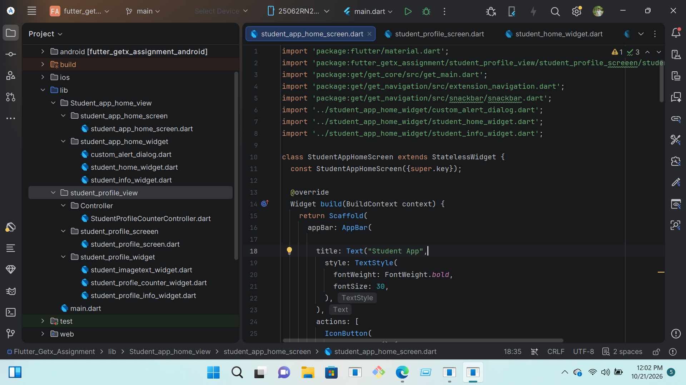

# futter_getx_assignment

# Flutter Batch 02 Assignment

<p align="center">
 
  
</p>

<h2 align="center">Flutter Batch 02 Assignment</h2>

<p align="center">
  A modern Flutter application built with Flutter and Dart.
</p>

<p align="center">
  
  
  
</p>

---

## 📱 About the Project

This project was developed as part of the Flutter Batch 02 assignment. It focuses on building a clean, user-friendly mobile application using Flutter, Dart, and reusable UI components.

## ✨ Features

- Modern and clean user interface
- Reusable Flutter widgets
- Organized code structure
- User-friendly screen layouts
- Android application support

## 🖼️ App Screenshots

### Screen 1 — Home Screen

<p align="center">
  
</p>

### Screen 2 — Profile Screen

<p align="center">
  
</p>

### Screen 3 — Details Screen

<p align="center">
  
</p>

## 🛠️ Technologies Used

- Flutter
- Dart
- Material Design

## 🚀 Getting Started

### Prerequisites

- Flutter SDK
- Dart SDK
- Android Studio or Visual Studio Code

### Installation

**1. Clone the repository**

```bash
git clone https://github.com/abirprogrammer/Flutter_Batch_02_Assignment.git
```

**2. Open the project folder**

```bash
cd Flutter_Batch_02_Assignment
```

**3. Install dependencies**

```bash
flutter pub get
```

**4. Run the application**

```bash
flutter run
```

## 📂 Project Structure

```text
Flutter_Batch_02_Assignment/
├── lib/
├── screenshots/
│   ├── profile_screen.png
│   └── details_screen.png
├── screenshorr.png
├── pubspec.yaml
└── README.md
```

## 👨‍💻 Author

**Md. Abir Bin Kabir**

GitHub: [@abirprogrammer](https://github.com/abirprogrammer)

## 📄 License

Created for educational and learning purposes.

---

<p align="center">
  Made with ❤️ using Flutter
</p>
